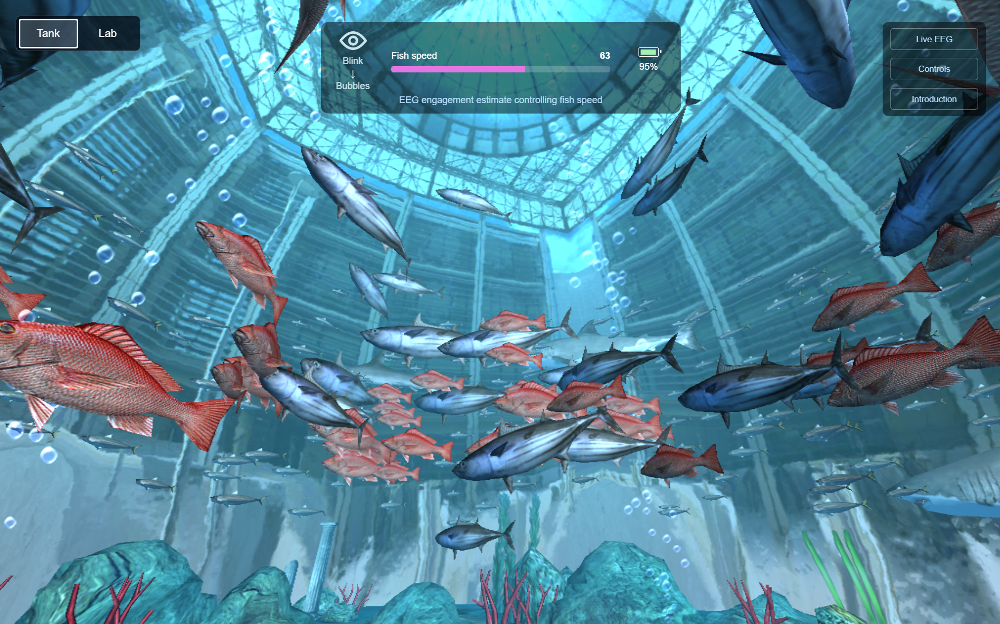
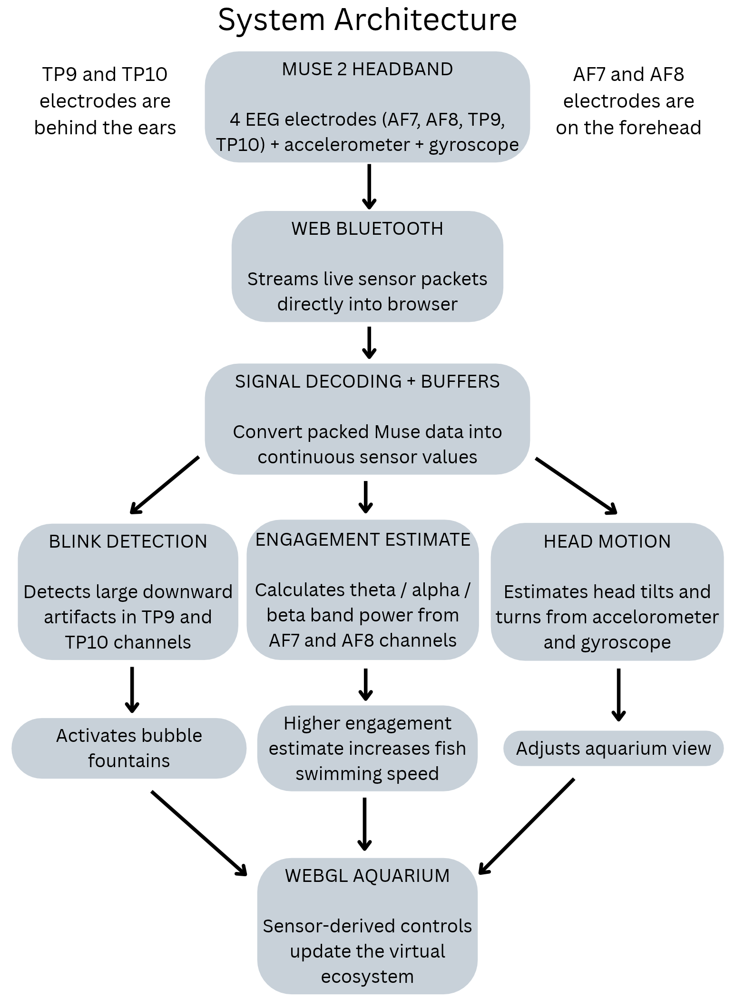
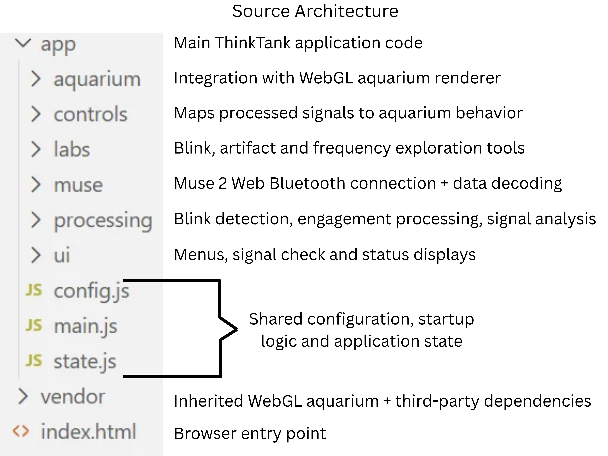

# ThinkTank

**ThinkTank is a browser-based, Muse 2–controlled aquarium that I built to explore how noisy signals from a consumer EEG headset can become real-time computer inputs.** It combines EEG acquisition and processing, head-motion sensing, live signal displays, and interactive controls. The aquarium connects this experiment with my longstanding interest in the ocean and makes the output of the algorithms immediately visible.



**Live application:** [thinktank.fish](https://thinktank.fish)  
**Source code:** [github.com/elessar-evenstar/think-tank](https://github.com/elessar-evenstar/think-tank)

A Muse 2 headset is required for live sensor control. Without one, visitors can view the aquarium and introductory material but cannot reproduce the EEG interactions.


## Features

ThinkTank has two modes: **Tank**, where signals control the aquarium, and **Lab**, where the signals can be explored without changing the aquarium's behavior. Both use live Muse 2 data acquired through Web Bluetooth.

### Tank Mode

| Input                        | Signal and processing                                                                  | Aquarium behavior                                        |
| ---------------------------- | -------------------------------------------------------------------------------------- | -------------------------------------------------------- |
| **Blink**                    | Short, baseline-relative downward deflections in the TP9 and TP10 electrode recordings | Triggers five bubble fountains                           |
| **Experimental EEG feature** | Frequency-band power calculated from AF7 and AF8 EEG                                   | Adjusts fish swimming and animation speed                |
| **Left/right head turn**     | Gyroscope angular velocity, with smoothing and a dead zone                             | Zooms the camera in or out by changing its field of view |
| **Up/down head movement**    | Accelerometer-based pitch and movement estimation                                      | Changes the camera viewing angle                         |

The Fish speed number and colored bar show the applied swimming-speed setting on a 0–100 scale: 0 is the slowest configured speed and 100 is the fastest. The number is not a percentage of attention. The bar changes length and color with speed and turns gray when clean EEG control input is unavailable.

The interface also displays live EEG traces from TP9, AF7, AF8, and TP10. A signal-check screen assesses data usability after connection, before entering Tank.

### Lab Mode

Lab includes three interactive activities:

- **Blink Explorer:** Presents ten prompted blink opportunities, plots TP9 and TP10, and displays detections during and outside the prompts.
- **Artifact Explorer:** Uses illustrative examples and short recordings to compare still EEG with recordings during jaw clenching and head movement and observe how they interfere with blink detection.
- **Frequency Explorer:** Shows illustrative waves, a live EEG spectrum and theta/alpha/beta powers, and two 15-second exercises: **Focused Attention** and **Quiet Rest**. The engagement estimate number is visible during both exercises. During focused attention, the user watches the number and tries to increase it; during quiet rest, the user lets attention wander without trying to follow or change the number. Afterward, a graph overlays both recordings for comparison, with gaps where no accepted estimate was recorded.

The Lab exercise displays the smoothed EEG engagement estimate, also on a 0–100 scale, rather than the applied fish speed. Both use the same EEG processing, but Tank mode adds speed smoothing and a return to baseline when input is unavailable, so the displayed numbers can differ.

In Lab mode, sensor acquisition and processing continue, but sensor-driven aquarium controls are paused. Returning to Tank resumes control gradually.

## Project Contributions

I adapted Muse Bluetooth connection and EEG packet-decoding logic from **[web-muse](https://github.com/itayinbarr/web-muse)**. I developed and integrated data buffering, blink-related artifact detection, EEG frequency and head-motion analysis, signal visualization and usability checks, aquarium controls, and the three Lab activities. The five-fountain implementation adapts the existing aquarium's particle system.

The 3D environment is based on **[Google's open-source WebGL Aquarium](https://github.com/WebGLSamples/WebGLSamples.github.io/tree/master/aquarium)** (credited there to Greggman and Human Engines). It provides the WebGL renderer, aquarium scene, fish models, textures, shaders, and much of the underlying animation and particle infrastructure. The original aquarium also provides general animation-speed and fish-tail-speed settings; ThinkTank maps processed Muse input onto them and adapts the timing to support responsive fish movement.

ThinkTank-specific software and adapted Muse acquisition code are primarily in `app/`, while the inherited aquarium code and libraries are under `vendor/`. The upstream `vendor/aquarium/aquarium.js` contains limited, opt-in integration changes for bubbles, fish-tail timing, input handling, and startup. Upstream copyright and license notices are retained, including `vendor/aquarium/LICENSE.md`; TDL and jQuery are also third-party libraries. Muse hardware and its Bluetooth protocol are third-party technology. ChatGPT assisted with some technical explanations, debugging, and partial code generation and revision.

## System Architecture



### Source Architecture



ThinkTank is a static web application. Its JavaScript modules share state and functions through `window.ThinkTank`. 

### Acquiring and checking EEG data

Muse EEG notifications contain 12 packed 12-bit samples per packet. ThinkTank decodes the samples, recenters and scales them, and tracks packet sequence counters to align channels and handle duplicate, missing, or stale data. The EEG analysis assumes 256 samples per second and uses the four built-in electrodes: TP9, AF7, AF8, TP10.

After connection, the signal-check screen examines all four displayed EEG channels for continuity, excessive amplitude, and near-flat measurements. It also waits for a fresh accepted frequency-analysis result and a period of stable conditions before enabling the Continue to Tank button. A warned Continue Anyway option appears after 30 seconds. 

## Signal Processing

### 1. Blink detection — TP9 and TP10

A blink produces an eye-related electrical artifact that can appear as a downward deflection in the Muse electrode recordings. 

For each of TP9 and TP10, the algorithm compares the newest 14 samples with the 96 preceding baseline samples:

```text
channel dip = max(0, baseline mean − minimum of newest 14 samples)
common dip  = (TP9 dip + TP10 dip) / 2
noise       = max(12, average baseline standard deviation of TP9 and TP10)
score       = common dip / noise
```

A blink candidate must satisfy all of these conditions:

- Common dip of at least 70 scaled signal units.
- A dip of at least 35 in each of TP9 and TP10.
- A noise-normalized score of at least 2.8.
- Sufficient agreement in dip amplitude between the two channels.

The detector also uses lower release thresholds (common dip 28 and score 1.2) for hysteresis, plus a 520 ms cooldown to avoid repeated detections from one event. 

When a blink is detected in Tank mode, all five bubble fountains are activated. They fade in over 0.5 seconds, stay visible for independently randomized durations of 2–3 seconds, and fade out over 1–2.5 seconds. The original aquarium's automatic random bubble triggering is disabled for ThinkTank.

### 2. Frequency-domain EEG feature — AF7 and AF8

Unlike the blink detector, which looks for a short event in time, the continuous control examines the relative strength of different EEG frequencies.

About every 600 ms, ThinkTank attempts to analyze a 512-sample window (about two seconds at 256 Hz) from each frontal channel. For each channel, it:

1. Removes the mean (DC offset).
2. Applies a Hann window.
3. Uses direct discrete Fourier calculations for selected frequency bins (not an FFT).
4. Estimates power in theta (4–7 Hz), alpha (8–12 Hz), and beta (13–30 Hz).

The corresponding powers from AF7 and AF8 are averaged after each channel is analyzed, so signals with opposite phase do not cancel before frequency analysis. The experimental control feature is:

```text
R = beta power / (alpha power + theta power + small constant)
```

The ratio is clamped to 0.2–2.6 and mapped linearly onto a 0–100 control score:

```text
raw score = 100 × (clamp(R, 0.2, 2.6) − 0.2) / 2.4
```

These endpoints are fixed experimental control thresholds. The first usable result initializes the estimate; later results are smoothed with approximately a 3-second time constant. Lab displays this smoothed estimate.

In Tank, the estimate sets a target speed multiplier from 0.15× to 2.4× relative to the aquarium's baseline animation and tail-speed settings. These speed endpoints are intended to make changes visibly apparent. An additional smoothing step moves the applied speed toward that target. The Fish speed meter maps the applied multiplier back onto 0–100, so it follows the aquarium's current speed setting rather than directly displaying the EEG estimate.

Before accepting a new window, the algorithm checks for large or invalid readings, near-flat activity in either frontal channel, recent detected blinks, and substantial head motion. If it rejects the data or the stream becomes stale, it holds the last valid EEG estimate internally instead of treating missing information as a low score. The Lab exercise shows `--` when a current usable estimate is unavailable and leaves gaps in the recording. After three seconds without a fresh accepted estimate, the aquarium speed gradually returns toward its normal baseline. Tank's gray speed meter continues to reflect that applied speed.

**Scientific limitation:** This beta/(alpha + theta) feature is an experimental EEG engagement-related control index, not a validated measure of attention, concentration, or mental state. Muscle activity, contact quality, and other artifacts can still affect the calculation. The band-power values are relative Fourier-derived powers, not fully normalized power spectral densities.

### 3. Head-motion processing

Head movements use the Muse's motion sensors, not EEG decoding:

- **Left/right:** Z-axis gyroscope readings are smoothed; motion within a 12°/s dead zone is ignored. Larger turns gradually adjust camera field of view within 45–120°. In the current mapping, turning left zooms out and turning right zooms in.
- **Up/down:** Pitch is estimated from the accelerometer and gravity using `atan2(ax, sqrt(ay² + az²))`, then smoothed relative to an adaptive neutral position. The detected direction and movement speed gradually adjust the aquarium camera's viewing target.

## Run Locally

**Requirements:** Muse 2 headset (for live controls), Bluetooth-capable computer, Chrome or Edge with Web Bluetooth support, and WebGL support. Use HTTPS when hosted or localhost when running locally.

From the repository root, run:

```bash
python serve.py
```

On Windows, `py serve.py` also works. Open http://localhost:8080/, click Connect Muse, select the headset, and follow the signal-check instructions. No npm installation or build process is needed. Opening `index.html` directly as a `file:` URL is not supported because the app loads shaders and models over HTTP.

## Limitations

Consumer-grade dry-electrode EEG can vary with headset fit, user, session, movement, and electrical interference. The blink and frequency algorithms use fixed configuration values and heuristic artifact checks; they can miss events or misinterpret artifacts. The interactive Lab activities do not establish independently labeled detector accuracy or clinical/psychological validity. 
